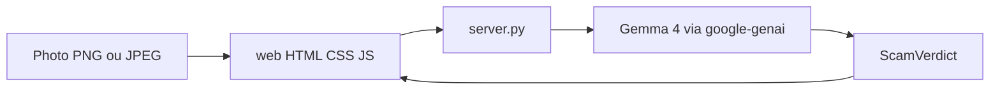

# SafeMomo Togo

Bouclier open source contre les faux reçus Mobile Money au Togo. Une photo, une phrase dite à voix haute, avant que l'argent ou la marchandise parte.

Construit avec **Gemma 4** pour le Hacktoberfest Hack Day Lomé × Python Togo.

[](https://opensource.org/licenses/MIT)
[](https://www.python.org/downloads/)
[](https://ai.google.dev/gemma/docs/core/gemma_on_gemini_api)
[](./SKILL.md)

**English, in one paragraph.** In Lomé, people hand over goods or send money back because a picture looks like a T-Money or Flooz receipt. SafeMomo sends that picture to Gemma 4 and answers with one spoken French sentence. The risk score stays behind a "why" panel. The project is MIT-licensed, published as an agent skill, and ships an offline demo when the network fails.

## Pour le jury

Quatre faits, lisibles sans ouvrir le code.

1. **Le geste.** Une photo, une phrase en français, dite à voix haute. La vendeuse n'a pas de score à interpréter. `*145#` reste la vérification du solde.
2. **Gemma 4, vraiment.** `gemma-4-26b-a4b-it` lit l'image. `gemma-4-31b-it` est le second choix. **Voir l'exemple** appelle le modèle, pas une phrase en cache. **Écouter** demande la voix Charon à Gemini.
3. **Open source, pas une archive.** Licence [MIT](./LICENSE), dépôt public, [SKILL.md](./SKILL.md) réutilisable, tests sans appel réseau, photo d'exemple synthétique, clé absente de git. Contribuer, signaler, relancer : [CONTRIBUTING.md](./CONTRIBUTING.md), [SECURITY.md](./SECURITY.md), [CODE_OF_CONDUCT.md](./CODE_OF_CONDUCT.md).
4. **La démo tient si le wifi lâche.** Le mode démo le dit à l'écran. Il ne s'applique qu'au bouton **Dis-moi quoi faire**.

## Sommaire

1. [Pour le jury](#pour-le-jury)
2. [Le problème](#le-problème)
3. [Ce que fait SafeMomo](#ce-que-fait-safemomo)
4. [Démo en direct](#démo-en-direct)
5. [Installation](#installation)
6. [Architecture](#architecture)
7. [Contrat du verdict](#contrat-du-verdict)
8. [Arborescence](#arborescence)
9. [Tests](#tests)
10. [Équipe](#équipe)
11. [Prix visés](#prix-visés)
12. [Projet open source](#projet-open-source)
13. [Ressources](#ressources)
14. [Attribution IA](#attribution-ia)
15. [Licence](#licence)

## Le problème

À Lomé, on donne un téléphone, un sac de ciment ou de l'argent parce qu'une **image** ressemble à un reçu T-Money ou Flooz. Le nom de l'opérateur est dessiné dans la photo. Le message est collé dans WhatsApp, parfois transféré, parfois envoyé par un numéro personnel `+228`. Le canal officiel n'a rien envoyé.

Deux scènes, un seul geste.

- **Boutique.** Le client est devant le comptoir. Il montre « j'ai envoyé ». Il reste dix secondes pour décider.
- **Famille.** Un message demande de renvoyer l'argent tout de suite : erreur de numéro, frais d'hôpital, urgence.

`*145#` dit si le solde a vraiment changé. Encore faut-il comprendre que l'écran montré n'est pas une preuve. Une regex sur la boîte SMS ne voit pas une photo.

La personne qui décide n'est pas devant un tableau de bord. C'est une vendeuse, une mère, un fils ou une fille à côté d'elle. L'écran doit répondre par une couleur et une phrase, lue à voix haute.

## Ce que fait SafeMomo

1. On montre la photo du reçu ou du message.
2. **Gemma 4** regarde l'image : bandeau WhatsApp, reçu collé, numéro personnel, solde absent, poussée à agir maintenant.
3. L'écran affiche **une seule phrase** sur une carte rouge, ou sur une carte sombre si le message semble réel.
4. **Écouter** lit cette phrase en français. **Prévenir la famille** ouvre WhatsApp avec l'alerte déjà écrite.
5. **Voir pourquoi** garde le détail pour le jury : expéditeur, signaux, conseil, repère sur 100. Ce détail ne passe pas devant la phrase.

Un message qui ne semble pas être une arnaque ne donne jamais l'autorisation d'envoyer de l'argent. La phrase dit de vérifier avec `*145#`.

Le modèle par défaut est `gemma-4-26b-a4b-it` (rapide). `gemma-4-31b-it` est proposé dans le menu Équipe quand on veut plus de précision. Les deux passent par l'API Gemini, qui héberge Gemma 4.

Si le réseau ou la clé manque, le mode démo affiche une phrase préparée et le dit. L'application ne plante pas devant le jury.

## Démo en direct

L'écran à montrer est l'application web d'Eloge : HTML, CSS et JavaScript, servie par `server.py`.

```bash
python server.py
```

Puis ouvrir `http://localhost:8000`. Le terminal affiche aussi l'adresse à taper sur le téléphone, s'il est sur le même Wi-Fi. Dans le navigateur du téléphone : menu, puis « Ajouter à l'écran d'accueil ».

Avec une clé dans `.env` et du réseau, `server.py` la charge tout seul. La clé ne s'affiche pas.

1. **Voir l'exemple.** La photo `samples/fake_tmoney_sample.png` part vers Gemma 4. Ce bouton ignore le mode démo.
2. Laisser la carte, puis appuyer sur **Écouter**. La voix vient de Gemini, voix Charon.
3. S'il reste quelques secondes, ouvrir **Voir pourquoi**, montrer un signal, s'arrêter.

Si la clé ou le wifi n'est pas sûr : menu Équipe, cocher **Mode démo sans internet**, refermer, puis **Dis-moi quoi faire**. Phrase préparée : « Ne renvoie rien. Ce message n'est pas un vrai T-Money. Tape *145#. » L'écran dit que c'est une démo.

Le créneau des finalistes dure 120 secondes et se fait sans démo. Cette séquence sert à la vidéo de présélection et à un écran montré avant le pitch.

## Installation

Python 3.10 ou plus récent.

```bash
git clone https://github.com/creedemmanuel7-sketch/SafeMomo-Togo.git
cd SafeMomo-Togo
pip install -r requirements.txt
```

Dépendances : Streamlit, `google-genai`, Pillow, Pydantic. L'écran web n'ajoute aucun paquet. `server.py` et `app.py` lisent `.env` sans bibliothèque en plus.

Créer ou éditer `.env` à la racine. Ce fichier est ignoré par git.

```text
GEMINI_API_KEY=ta_cle_ici
```

La clé se crée dans [Google AI Studio](https://aistudio.google.com/apikey). Pas de guillemets, pas d'espace autour du `=`. `GOOGLE_API_KEY` est accepté en secours. `GET /api/config` dit seulement si une clé est présente. Il ne renvoie jamais la clé.

Écran web, celui de la démo :

```bash
python server.py
```

`http://localhost:8000` sur cet ordinateur. L'adresse pour le téléphone s'affiche dans le terminal.

L'écran Streamlit reste disponible pour l'équipe :

```bash
streamlit run app.py
```

Il écoute en général sur `http://127.0.0.1:8501`.

## Application web

Eloge a posé l'écran de la vendeuse en HTML, CSS et JavaScript, dans `web/`. `server.py` est le pont : il reçoit la photo et appelle `analyzer.py`. Il n'ajoute pas de règle de fraude.

Routes :

| Route | Rôle |
|---|---|
| `POST /api/analyze` | Corps = image brute. En-têtes optionnels `X-Api-Key` et `X-Model`. Réponse : `{"verdict": {...}}` |
| `GET /api/demo` | Verdict préparé, sans réseau |
| `GET /api/config` | Modèles Gemma 4, et `server_key` vrai ou faux. Jamais la clé |
| `POST /api/speak` | Corps `{"text": "..."}`. Réponse audio WAV, voix Charon |

Une erreur revient sous `{"error": {"kind", "detail"}}`. L'écran la traduit en une phrase française avec une action.

Régénérer l'image d'exemple :

```bash
python samples/generate_sample.py
```

Le dessin est synthétique. Il ne contient aucun SMS réel ni donnée personnelle.

## Architecture



| Fichier | Rôle |
|---|---|
| `web/` | Écran installable : photo, carte, voix, WhatsApp. HTML, CSS, JavaScript |
| `server.py` | Pont sans nouvelle dépendance. Lit `.env`, sert `web/`, appelle le verdict |
| `analyzer.py` | Appel Gemma 4, image réduite en JPEG, JSON réparé, verdict validé |
| `app.py` | Écran Streamlit de l'équipe, même clé `.env`, même verdict |
| `ui.py` | Mise en page de l'écran Streamlit |
| `UX.md` | Brief des états pour l'interface |
| `SKILL.md` | Même raisonnement, au format Agent Skill |
| `samples/` | Photo de démo et script qui la dessine |
| `tests/` | Parsing JSON et taille de l'image envoyée |

L'image est ramenée à 1280 px sur le plus grand côté, en JPEG, avant l'envoi. L'appel demande du JSON, désactive le raisonnement long (`thinking_level` minimal) et retente une fois sans mode JSON si l'API refuse la configuration. Une réponse entourée de markdown ou une virgule finale est rattrapée avant l'affichage.

Le menu Équipe reste replié. Il sert à la clé, au choix du modèle et au mode démo. Il n'est pas l'écran de la vendeuse.

L'interface visible peut être remplacée. Le contrat à garder est `analyze_screenshot()` et `demo_verdict()` dans `analyzer.py`. Le prompt et le parseur ne se réécrivent pas dans le front.

## Contrat du verdict

```json
{
  "is_scam": true,
  "risk_score": 98,
  "scene": "famille",
  "verdict_title": "Faux transfert montré en image",
  "spoken_sentence": "Ne renvoie rien. Ce message n'est pas un vrai T-Money. Tape *145#.",
  "sender_analysis": "L'avis affiché vient d'un numéro personnel, pas du canal TMONEY.",
  "red_flags": ["Le reçu est une capture, pas un SMS du canal TMONEY"],
  "plain_advice": "Ne donne pas d'argent. Tape *145#.",
  "whatsapp_alert": "ALERTE : on vous montre une photo de transfert pour vous faire renvoyer de l'argent."
}
```

| Champ | Où il apparaît |
|---|---|
| `spoken_sentence` | Seule phrase en grand, et phrase lue par Écouter |
| `scene` | `boutique`, `famille` ou `autre`. Petit libellé au-dessus de la phrase |
| `is_scam` | Carte rouge, ou carte « vérifie quand même » |
| `whatsapp_alert` | Texte du bouton Prévenir la famille |
| `verdict_title`, `sender_analysis`, `red_flags`, `plain_advice`, `risk_score` | Uniquement dans Voir pourquoi |

`scene` vaut `boutique` quand un client montre un reçu pour emporter une marchandise, `famille` quand on demande de renvoyer de l'argent.

Les sept états d'écran sont décrits dans [UX.md](./UX.md) : vide, photo prête, attente, danger, à vérifier, démo, erreur.

## Arborescence

```text
SafeMomo-Togo/
├── SKILL.md
├── README.md
├── UX.md
├── HANDOVER_CURSOR.md
├── LICENSE
├── CONTRIBUTING.md
├── SECURITY.md
├── CODE_OF_CONDUCT.md
├── requirements.txt
├── .gitignore
├── app.py
├── ui.py
├── analyzer.py
├── server.py
├── web/
│   ├── index.html
│   ├── app.css
│   ├── app.js
│   ├── manifest.webmanifest
│   └── sw.js
├── samples/
│   ├── generate_sample.py
│   └── fake_tmoney_sample.png
└── tests/
    └── test_analyzer.py
```

`.env` reste sur la machine qui fait la démo. Il n'est pas versionné.

## Tests

```bash
python -m unittest tests.test_analyzer -v
```

Les tests couvrent un JSON entouré de markdown, une virgule finale, l'absence de `spoken_sentence`, la scène `shop` ramenée à `boutique`, et la réduction de l'image. Ils n'appellent pas l'API.

## Équipe

Équipe SafeMomo, Hacktoberfest Hack Day Lomé 2026 :

- **ADJIGNON K. Crédo** — Team Lead, Core AI Architect & Repo Maintainer
- **HEMAZRO Eloge** — Lead Frontend et UX, application web HTML, CSS et JavaScript
- **AKOMAGBE E. Stéphane** — Lead QA, Datasets & Demo Specialist
- **HAMADOU Nassif** — Lead Product & Final Pitcher

Dépôt public : <https://github.com/creedemmanuel7-sketch/SafeMomo-Togo>

## Prix visés

Une seule soumission peut entrer dans les deux catégories.

- [Best Use of Gemma 4](https://www.mlh.com/events/hacktoberfest-hack-day-lome-x-python-togo/challenges/01a03b87-be22-9180-5e2d-b3beeb66666d) — Gemma 4 lit une image et produit l'action à dire.
- [Best Open-Source AI Project](https://www.mlh.com/events/hacktoberfest-hack-day-lome-x-python-togo/challenges/01a0d987-0c41-12ea-13ac-5b85755dc2f3) — licence MIT, dépôt public, skill réutilisable dans [SKILL.md](./SKILL.md).

Événement : [Hacktoberfest Hack Day Lomé × Python Togo](https://www.mlh.com/events/hacktoberfest-hack-day-lome-x-python-togo) · fiche [OrganizerHQ / MLH](https://events.mlh.com/events/15369-hacktoberfest-hack-day-lome-x-python-togo).

## Projet open source

Ce dépôt est fait pour être repris, pas seulement noté.

| Pièce | Où |
|---|---|
| Droit d'usage, de modification, de redistribution | [LICENSE](./LICENSE), MIT |
| Lancer, tester, ouvrir une pull request | [CONTRIBUTING.md](./CONTRIBUTING.md) |
| Ne pas publier une clé ni un SMS réel | [SECURITY.md](./SECURITY.md) |
| Règles entre personnes | [CODE_OF_CONDUCT.md](./CODE_OF_CONDUCT.md), celui de MLH |
| Même raisonnement, hors de cette application | [SKILL.md](./SKILL.md) |
| Ce que l'écran a le droit de montrer | [UX.md](./UX.md) |

Fork, branche, pull request vers `master`. Les textes visibles restent en français. Les noms de fichiers restent en anglais. Une contribution ne commit pas `.env`, ni une capture de SMS réel.

## Ressources

### Celles données pour la journée

Liens publiés sur la page de l'événement.

- [Agent Skills Explained: What They Are, What They Aren't, and How to Use Them](https://dev.to/loc_carrre_0d798813c662/agent-skills-explained-what-they-are-what-they-arent-and-how-to-use-them-bf9) — le standard `SKILL.md` suivi par ce dépôt.
- [A Developer's Guide to Open-Weight LLM API Integration](https://dev.to/sbt112321321/beyond-the-black-box-a-developers-guide-to-open-weight-llm-api-integration-1ea6) — intégrer un modèle open-weight par API.
- [How to Run Google's Gemma 4 Locally with Ollama](https://dev.to/purpledoubled/how-to-run-googles-gemma-4-locally-with-ollama-all-4-model-sizes-compared-2pbh) — Gemma 4 en local pour les tailles sous 10B. SafeMomo, pour la démo du jour, utilise les modèles hébergés.
- [Hermes Agent: A Practical Guide](https://dev.to/truongpx396/hermes-agent-the-self-improving-agent-framework-and-how-it-compares-to-openclaw-goclaw-22mc) — orchestrer un agent open source.
- [Gemma 4 Resources](https://mlh.link/gemma) — hub MLH.
- [Gemma Quickstart](https://mlh.link/gemma-quickstart) — premier appel API.
- [Gemma API Docs](https://mlh.link/gemma-docs) — référence des points d'accès.
- [Gemma Beginner Guide](https://mlh.link/gemma-beginnerguide) — parcours pour démarrer.

### Documentation Gemma utilisée par le projet

- [Run Gemma with the Gemini API](https://ai.google.dev/gemma/docs/core/gemma_on_gemini_api) — modèles hébergés `gemma-4-26b-a4b-it` et `gemma-4-31b-it`, images, thinking, instructions système.
- [Image understanding](https://ai.google.dev/gemma/docs/capabilities/vision/image) — entrée image de Gemma 4.
- [Gemini API, Gemma](https://gemma.ai/deployment/gemini-api/) — mêmes identifiants de modèles, côté Gemma.
- [Google AI Studio, clés API](https://aistudio.google.com/apikey) — créer `GEMINI_API_KEY`.
- SDK Python [`google-genai`](https://github.com/googleapis/python-genai) — client utilisé dans `analyzer.py`.

### Communauté et règles

- [Python Togo](https://www.pytogo.org/)
- [Discord Python Togo](https://www.pytogo.org/discord)
- [Code de conduite MLH](https://static.mlh.io/docs/mlh-code-of-conduct.pdf)
- [Licence MIT](https://opensource.org/licenses/MIT) — texte complet dans [LICENSE](./LICENSE)

### Ce qu'il faut pour un projet open source

Guides suivis pour que le dépôt se lise et se reprenne sans nous écrire.

- [Open Source Guides](https://opensource.guide/) — démarrer, accueillir une contribution, maintenir.
- [Starting a project](https://opensource.guide/starting-a-project/) — licence, README, public dès le premier jour.
- [How to contribute](https://opensource.guide/how-to-contribute/) — fork, branche, pull request, relecture.
- [Fichiers de santé d'un dépôt GitHub](https://docs.github.com/communities/setting-up-your-project-for-healthy-contributions) — `README`, `LICENSE`, `CONTRIBUTING`, `CODE_OF_CONDUCT`, `SECURITY`.
- [Politique de sécurité](https://docs.github.com/code-security/getting-started/adding-a-security-policy-to-your-repository) — le rôle de `SECURITY.md`.
- [Licence MIT](https://choosealicense.com/licenses/mit/) — texte choisi, identifiant SPDX `MIT`. Référence [SPDX](https://spdx.org/licenses/MIT.html) et [OSI](https://opensource.org/licenses/MIT).
- [Agent Skills, spécification](https://agentskills.io/specification) — format de [SKILL.md](./SKILL.md).
- [Code de conduite MLH](https://static.mlh.io/docs/mlh-code-of-conduct.pdf) — règles de la journée, reprises dans [CODE_OF_CONDUCT.md](./CODE_OF_CONDUCT.md).

### Dans ce dépôt

- [SKILL.md](./SKILL.md) — skill agent, même contrat que l'application
- [UX.md](./UX.md) — états, textes, couleurs, ce que l'écran a le droit de montrer
- [CONTRIBUTING.md](./CONTRIBUTING.md) — lancer, tester, proposer un changement
- [SECURITY.md](./SECURITY.md) — clé, SMS réels, signalement
- [CODE_OF_CONDUCT.md](./CODE_OF_CONDUCT.md) — conduite
- [LICENSE](./LICENSE) — MIT
- [HANDOVER_CURSOR.md](./HANDOVER_CURSOR.md) — contexte du sprint et commande de lancement
- [samples/generate_sample.py](./samples/generate_sample.py) — image synthétique de la démo

## Attribution IA

Comme le demande le Hacktoberfest Hack Day, des assistants de code ont servi à accélérer l'architecture, le format du skill et la documentation : GitHub Copilot, Google Antigravity et Cursor. Les décisions produit, les règles T-Money / Flooz et les textes montrés à l'écran restent ceux de l'équipe.

## Licence

[MIT](./LICENSE). Copyright (c) 2026 Python Togo Community Hackers.

On peut utiliser, modifier et redistribuer ce projet. L'avis de licence doit rester avec les copies. Le logiciel est fourni sans garantie. SafeMomo aide à regarder une image. Il ne remplace pas `*145#`, ni un avis juridique.
